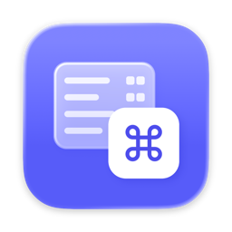
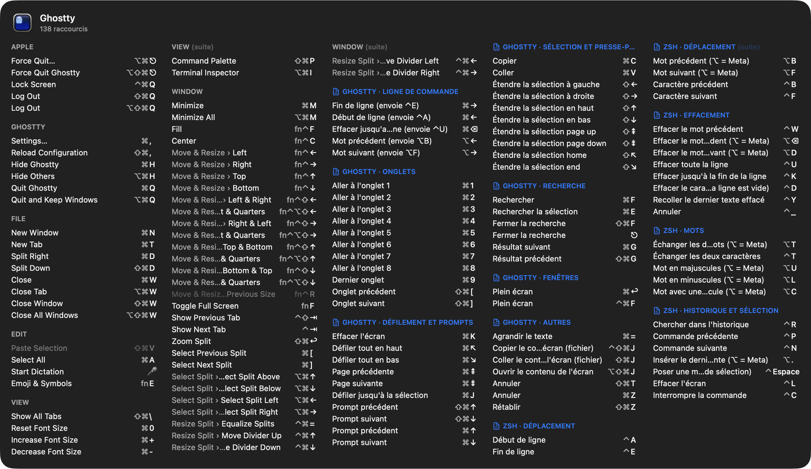
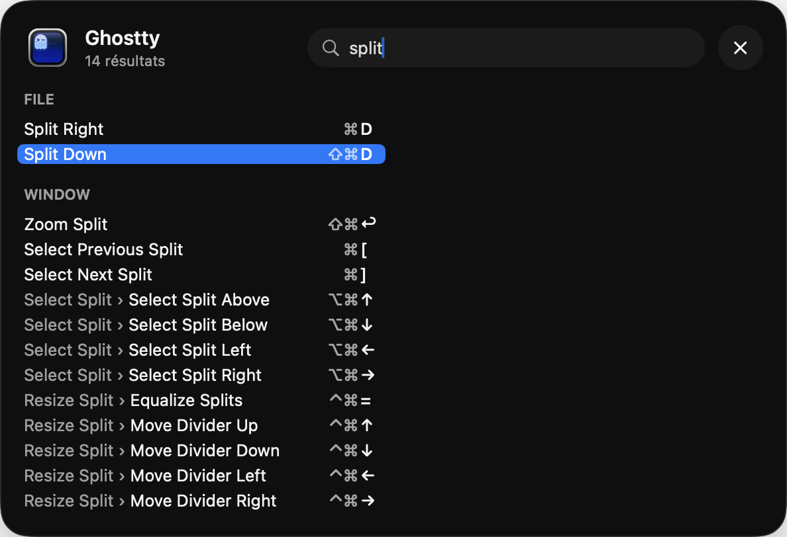
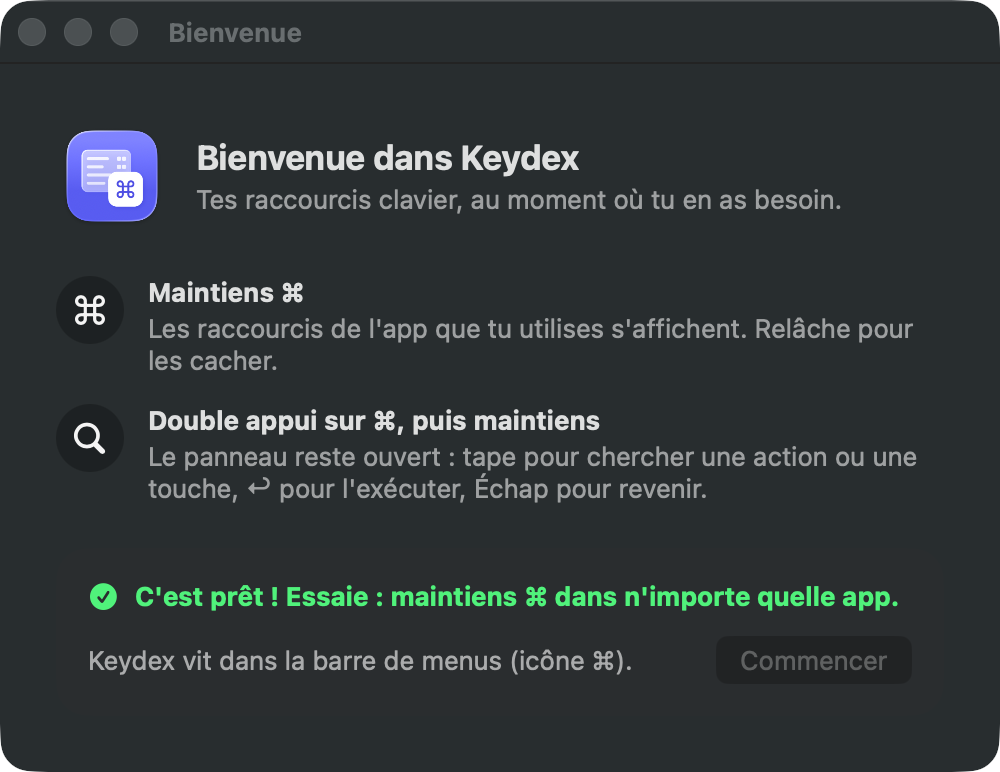
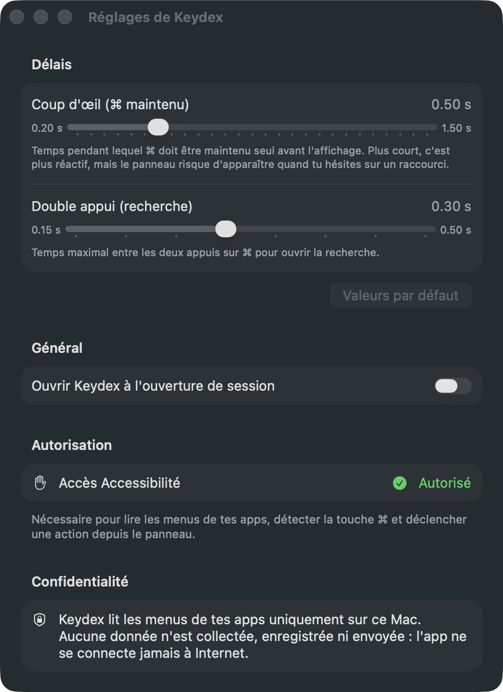
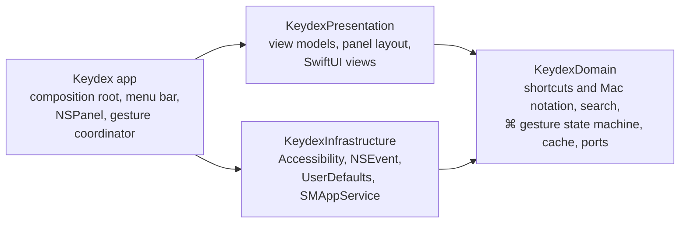

<div align="center">



# Keydex

**Hold ⌘ to see the keyboard shortcuts of the app you're using.**<br>
Double-tap ⌘ to search them and run an action, without leaving the keyboard.


[](LICENSE)



</div>

## Why

Moving to the Mac from Windows or Linux, your muscle memory breaks: the modifiers are different (⌘ ⌃ ⌥), conventions change, and you no longer know which shortcuts exist. Digging through menus or searching the web breaks your flow.

Keydex reads the shortcuts of the frontmost app **from its own menus**, completes them with **sheets** for the shortcuts no menu lists (shell line editing, terminal keybindings, system shortcuts), and shows them right when you need them, in a native panel that never steals focus. Use it until the shortcuts become muscle memory.

## Features

- **Glance**: hold **⌘** alone for half a second to see every shortcut of the frontmost app, grouped by menu in the app's own order. Release to hide it.
- **Search**: double-tap **⌘** and hold the second press. Type to filter by action name or by keys, **↑ ↓** to choose, **↩** to run the action in your app, **Esc** to go back exactly where you were.
- **Never in the way**: regular shortcuts (⌘C, ⌘Tab, ⌘-click, ⇧⌘…) never show the panel. Keydex only observes events and never intercepts them.
- **Beyond menus**: [shortcut sheets](docs/SHEETS.md), small Markdown files reloaded as soon as you save them, add the shortcuts that are in no menu. Bundled: zsh line editing, macOS system shortcuts, and Ghostty's keybindings, generated from Ghostty itself by a small script, so they always match your config.
- **Mac notation**: keys are shown as on a Mac keyboard and in macOS menus (fn ⌃ ⌥ ⇧ ⌘, ↩ ⌫ ⎋ ←…), including window tiling shortcuts such as `fn ⌃ ←`. Unavailable actions are dimmed.
- **Fits your screen**: menus flow through balanced columns, and long menus continue in the next column, so even IntelliJ IDEA fits without scrolling.
- **Fast and light**: shortcuts are prefetched when you switch apps and the panel is prerendered, so it appears with no perceptible delay. Idle: ~0% CPU, ~58 MB.
- **Native**: menu bar app (no Dock icon), Liquid Glass design, light and dark mode, opaque fallback when *Reduce transparency* is on.
- **Private**: no data collection, no network access. Everything stays on your Mac.

<div align="center">

</div>

### Search syntax

| You type | You get |
|---|---|
| `copy`, `find files` | Actions whose name (or menu, or submenu) contains every word. Case and accents are ignored. |
| `⌘⇧F`, `cmd shift f`, `Cmd+Shift+F` | Shortcuts using these keys. Modifiers can be glued or separated. |
| `ctrl`, `alt`, `opt`, `maj` | Windows/Linux and French words work for modifiers. |
| `esc`, `f5`, `left`, `←`, `space` | Special keys by name or symbol. |
| `⌃` | Every shortcut using Control. |

## Shortcut sheets

For shortcuts that no menu lists, drop a Markdown file in `~/.config/keydex/`:

```markdown
# fish
apps: Ghostty, Terminal

## Autosuggestions
- `⌃F` Accept the autosuggestion
- `⌥→` Accept the next word of the autosuggestion
```

It shows up at the next glance, without relaunching Keydex. See the [sheet guide](docs/SHEETS.md) for the format, priorities and how to share a sheet.

## Install

Keydex is built from source for now.

**Requirements**: macOS 26 or later, Xcode 26 or later, and [XcodeGen](https://github.com/yonaskolb/XcodeGen) (`brew install xcodegen`).

```sh
git clone https://github.com/cdu99/keydex.git && cd keydex
make install     # builds the Release app, copies it to /Applications and launches it
```

On first launch, Keydex explains why it needs the **Accessibility** permission and opens the right pane of System Settings. Turn Keydex on there and it's ready.

<div align="center">

&nbsp;

</div>

### Settings

From the ⌘ icon in the menu bar → **Réglages…**:
- the glance delay (0.2 to 1.5 s) and the double-tap interval, applied live;
- launch at login;
- the Accessibility permission status.

## Privacy and permissions

Keydex needs a single permission, **Accessibility**, to:
- read the menus of the frontmost app (titles, shortcuts, enabled state);
- observe the ⌘ key system-wide (observe only, never intercept);
- press a menu item when you run an action from the search.

It collects nothing, stores only its own settings (local user defaults), and contains no networking code. It is not sandboxed, because macOS does not allow the Accessibility API from sandboxed apps; this is also why it isn't on the Mac App Store.

## Limitations

- **Shortcuts that are in no menu** cannot be read from the app. They need a [sheet](docs/SHEETS.md): bundled (zsh, macOS), written by you, or generated by a command (Ghostty). IntelliJ IDEA's keymap is not covered yet.
- **Dimmed state may be stale**: some apps only refresh an item's enabled state when its menu is opened.
- **Secure input**: while a password field is focused, macOS hides keyboard events from other apps, so the panel cannot appear (by design).
- The UI is in French for now. Localization contributions are welcome.

## Roadmap

- [x] Shortcuts that aren't in menus: Markdown sheets, reloaded live, shown apart from the menu shortcuts.
- [x] Sheets generated by a command (Ghostty's keybindings, read live from Ghostty).
- [ ] IntelliJ IDEA's keymap.
- [ ] More bundled sheets (tmux, vim…): [contributions welcome](CONTRIBUTING.md).
- [ ] Key sequences in sheets ("⌃X then ⌃K").
- [ ] Windows/Linux → Mac equivalents ("Ctrl+Shift+F" → "⌘⇧F").
- [ ] Highlight shortcuts you don't use yet.
- [ ] Prebuilt, notarized releases.

## Architecture

Clean architecture: a local Swift package holds all the logic, and the app target only wires things together. The code is generic: it names no app. Everything specific to an app lives in [sheets](sheets) (Markdown, plus a script for generated ones).



- **KeydexDomain** is pure Swift with no AppKit. It holds the model, the search, the catalog cache, the ports, and the ⌘ gesture as a pure state machine driven by events and a timer, so every timing sequence is unit-tested.
- **KeydexInfrastructure** implements the ports with macOS APIs:
  - it reads menus with one IPC call per item;
  - it decodes Carbon glyphs and modifiers, including the undocumented fn bit;
  - it finds a menu item again by position and title before pressing it.
- **KeydexPresentation** contains:
  - the column flow layout, computed before rendering;
  - the panel and settings view models;
  - the SwiftUI views.

## Development

```sh
make run       # generate the Xcode project (XcodeGen), build Debug, launch
make test      # unit tests (Swift Testing) of the core package
make release   # optimized build
make clean
```

- The Xcode project is generated from `project.yml`, so it is not committed.
- **Signing**: to keep the Accessibility permission across rebuilds, sign with your free Apple development team. Create `Config/Signing.local.xcconfig` (git-ignored):
  ```
  DEVELOPMENT_TEAM = <your team ID>
  CODE_SIGN_IDENTITY = Apple Development
  CODE_SIGN_STYLE = Manual
  ```
- **Inspecting an app**: `swift run keydex-dump <app> [--raw] [--runs N] [--pause MS] [--perform TITLE]` (in `Packages/KeydexCore`) prints what Keydex reads from a running app and how long it takes. The terminal needs the Accessibility permission.
- **Checking a sheet**: `swift run keydex-dump --check-sheet <file.md>…`, or `-` to check what a sheet's command prints.
- **App icon**: `Keydex/Resources/AppIcon.icon` is an Icon Composer document generated by `scripts/make-app-icon.swift`. You can also open it in Icon Composer (bundled with Xcode).
- **Commits** follow [Conventional Commits](https://www.conventionalcommits.org/), one logical change per commit. See [CONTRIBUTING.md](CONTRIBUTING.md).
- [`logs.md`](logs.md) records the plan, design decisions, measurements and progress (in French).

## License

[MIT](LICENSE)
